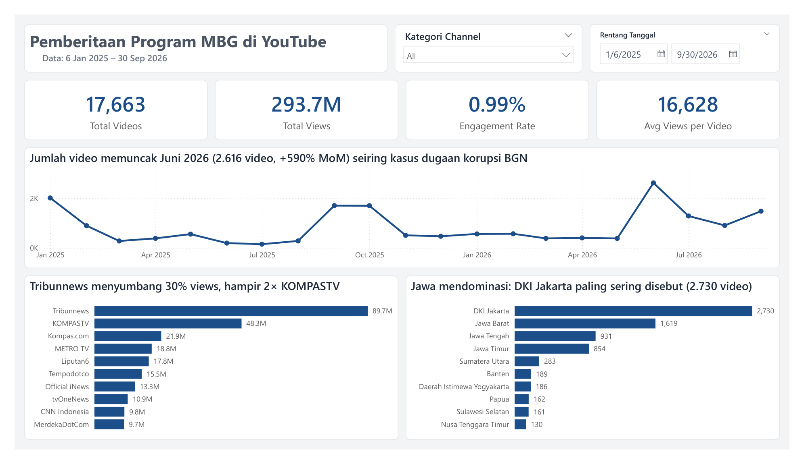
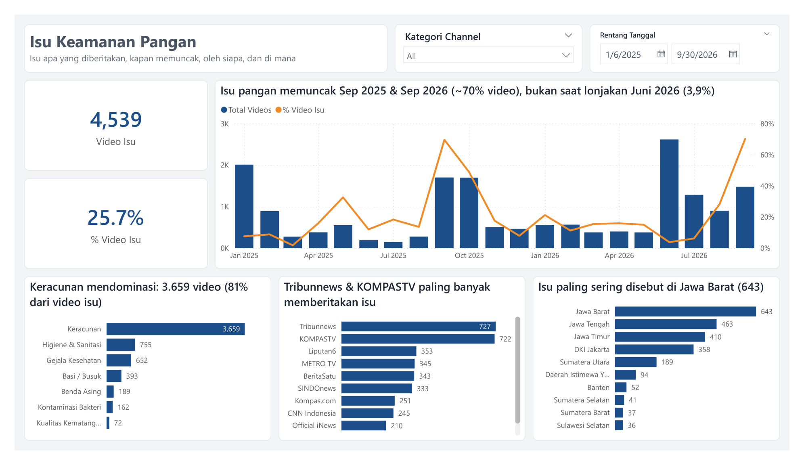
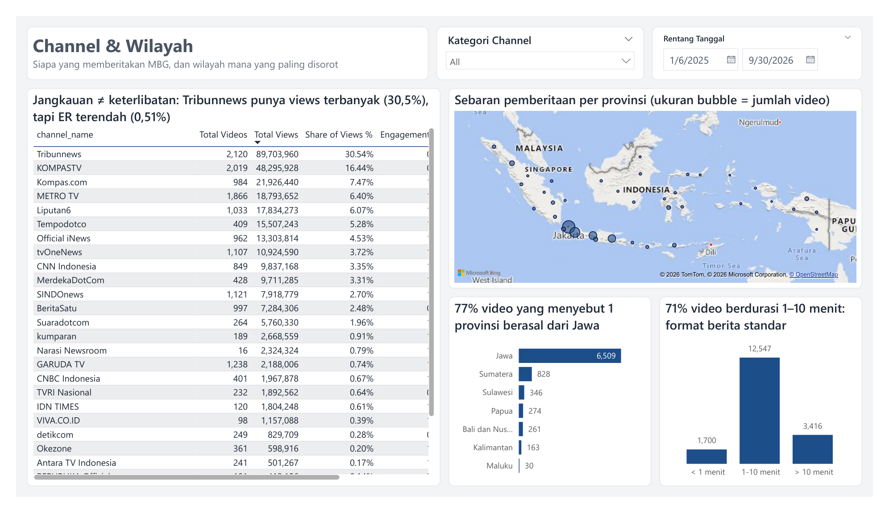

# YouTube Coverage of Indonesia's Free Nutritious Meals Program: Data Pipeline + Power BI Dashboard

An automated pipeline that collects **17,663 videos** about Indonesia's Free Nutritious Meals program (Makan Bergizi
Gratis, MBG) from **28 YouTube channels**, builds a **star schema** with data-quality checks, and presents it in a
**Power BI dashboard**.

```
YouTube Data API v3 ──► notebooks/youtube_pipeline.ipynb ──► scripts/build_star_schema.py ──► Power BI
                     (daily quota limit, resumes on rerun)   (star schema + 12 key & relationship checks)
```

**Tools:** Python (pandas, requests) · YouTube Data API v3 · Power BI (Power Query, DAX, PBIP) · Git

## Dashboard





## Key findings

- **June 2026** had the highest video count (2,616, +590% MoM), driven by an alleged corruption case at the National
  Nutrition Agency (BGN), while food-safety issues peaked separately in **September 2025 and 2026** (~70% of that
  month's videos).
- **Food poisoning** dominates food-safety coverage: 3,659 of the 4,539 videos that mention an issue.
- **Tribunnews** accounts for 30.5% of 293.7 million views but has the lowest engagement rate (0.51%).
- **77%** of videos that mention a single province are about Java.

## Technical highlights

- **Pipeline:** API usage is capped at 9,000 of the 10,000-unit daily quota, failed requests are retried
  automatically, and when rerun the next day, collection continues from where it stopped instead of starting over.
- **Data quality:** 12 automated checks (unique keys, every fact key exists in its dimension, etc.); the script exits
  with an error if any check fails, and results are logged in `data/star/build_log.json`.
- **Model:** 2 fact tables (`fact_videos`, `fact_video_issue`) + 4 dimensions, one-directional 1:* relationships.
- **DAX:** every number uses an explicit measure, including MoM (`DATEADD`) and `DISTINCTCOUNT` for videos with
  multiple issues.
- **PBIP:** visuals, tables, and measures are stored as text files, so changes can be reviewed in Git.

## Repository structure

```
├── notebooks/youtube_pipeline.ipynb   Data collection from the YouTube API + cleaning + location extraction
├── scripts/build_star_schema.py       Builds the star schema + runs 12 data-quality checks
├── data/star/                         Power BI-ready tables
├── youtube-powerbi.pbip               Dashboard (open in Power BI Desktop)
├── youtube-powerbi.Report/            Pages and visuals
├── youtube-powerbi.SemanticModel/     Tables, relationships, and DAX measures
└── docs/screenshots/                  Dashboard screenshots
```

## How to run

**View the dashboard**
1. Open `youtube-powerbi.pbip` in Power BI Desktop.
2. Go to **Transform data → Edit parameters** and set `DataFolder` to the location of the `data\star\` folder
   (ending with `\`).
3. Click **Refresh**.

**Rerun the pipeline**
```bash
pip install -r requirements.txt
copy .env.example .env                 # fill in YT_API_KEY
jupyter notebook notebooks/youtube_pipeline.ipynb
python scripts/build_star_schema.py
```
The per-video issue labels (`data/source/youtube_labels.csv`) are a separate input and are not included.

## Limitations

- Only public video metadata from media and official government channels is used; comments and viewer identities
  are not included.
- Locations come from region names mentioned in titles/descriptions and may not be where the event happened.
- Views and likes are a snapshot taken at collection time. Period: January 6, 2025 – September 30, 2026.
